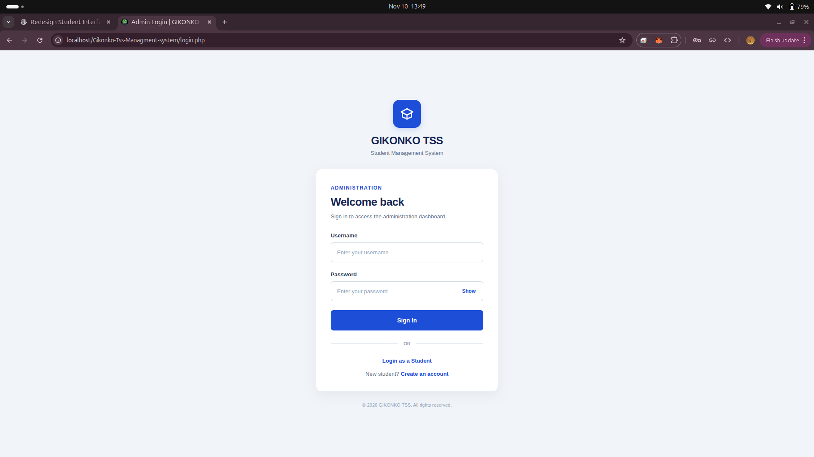
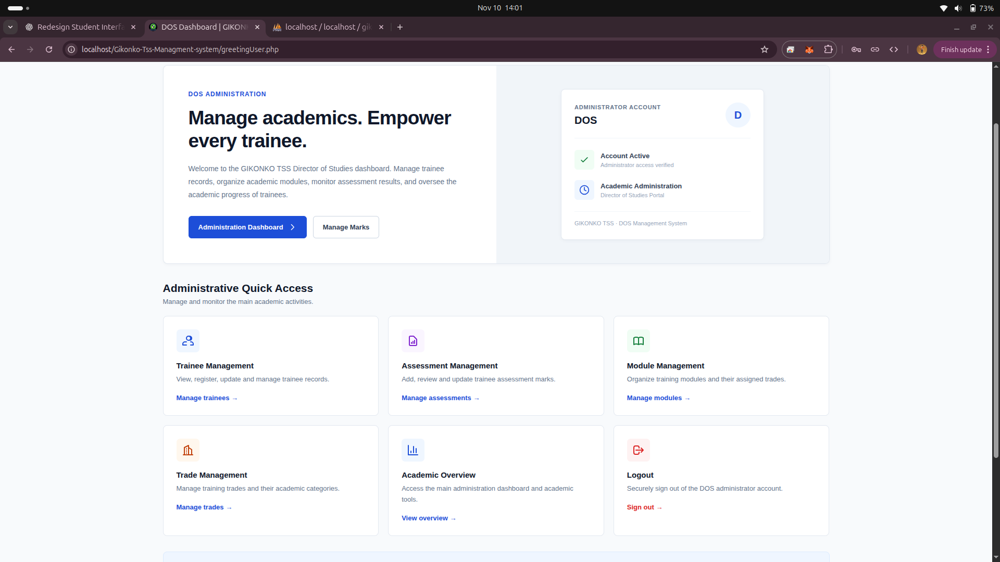
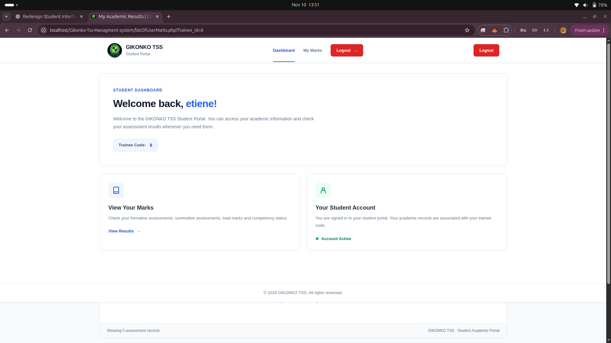
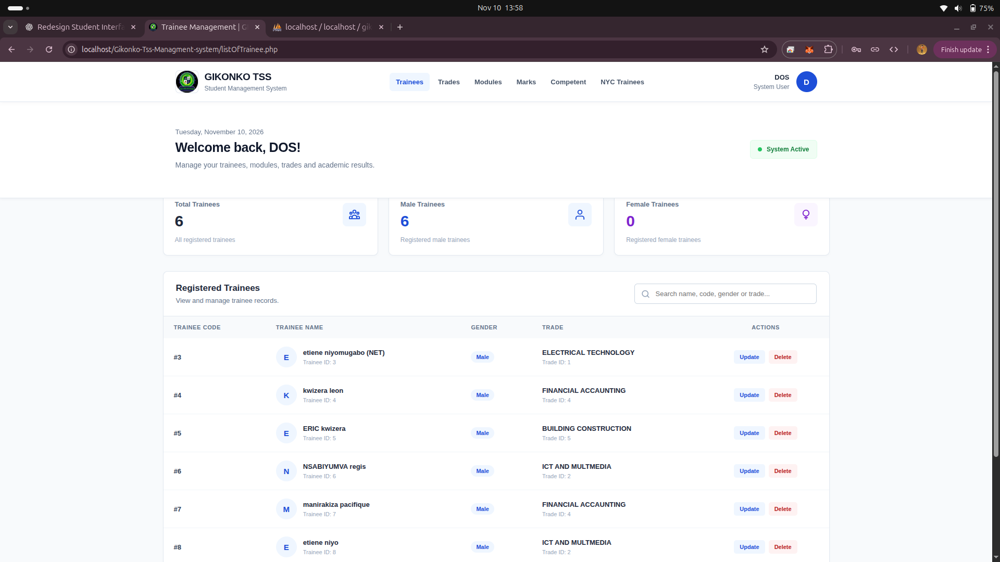

# GIKONKO TSS – Trainee Management System

A web-based academic management system developed for **GIKONKO Technical Secondary School (GIKONKO TSS)**. The system helps the Director of Studies (DOS) manage trainee records, training trades, modules, and assessment marks while allowing trainees to securely access their academic information.

**Created by:** NIYOMUGABO Etiene

**Portfolio:** [https://niyomugaboetiene.vercel.app](https://niyomugaboetiene.vercel.app)

---

## 📌 Project Overview

The GIKONKO TSS Trainee Management System provides a centralized platform for managing academic activities.

It has two main portals:

- **DOS Administration Portal:** Allows the Director of Studies to manage trainees, trades, modules, marks, and academic performance.
- **Trainee Portal:** Allows trainees to log in and access their academic information and assessment results.

The system is designed with a clean, responsive interface that works on desktop and mobile devices.

---

## 🖥️ Application Screenshots

### 1. Login Page



### 2. DOS Administration Portal



### 3. Trainee Portal



### 4. Trainee Management



---

## ✨ Key Features

### DOS Administration Portal

- Secure administrator login.
- Register and manage trainees.
- View, update, and delete trainee records.
- Manage training trades.
- Manage academic modules.
- Assign modules to trades.
- Record formative and summative assessment marks.
- Update trainee assessment results.
- View competent trainees.
- View not-yet-competent trainees.
- Monitor academic performance.

### Trainee Portal

- Secure trainee login.
- Access personal student information.
- View academic marks.
- Check formative and summative assessment results.
- View total marks and competency decisions.
- Access the student profile.
- Securely log out.

### Assessment Management

The system uses the following grading structure:

| Assessment | Maximum Marks |
|---|---:|
| Formative Assessment | 50 |
| Summative Assessment | 50 |
| Total Marks | 100 |

**Competency decisions:**

- **Competent:** 70–100 marks.
- **Not Competent:** Below 70 marks.

---

## 🛠️ Technologies Used

| Technology | Purpose |
|---|---|
| PHP | Backend development |
| MySQL | Database management |
| HTML5 | Page structure |
| CSS3 | Responsive user interface |
| JavaScript | Client-side interactions |
| MySQLi | Database connectivity |

---

## 📂 Project Structure

```text
GIKONKO-TSS/
│
├── conn.php
├── login.php
├── loginStudent.php
├── register.php
│
├── greetingUser.php
├── Dashboard.php
├── DashboardStudent.php
├── userDashboard.php
├── userPage.php
│
├── listOfTrainee.php
├── listOfTrades.php
├── listOfModule.php
├── listOfMarks.php
│
├── addTrainee.php
├── addTrade.php
├── addModule.php
├── addMarks.php
│
├── updateTrainee.php
├── updateTrade.php
├── updateModule.php
├── updateMarks.php
│
├── studentMarks.php
├── studentProfile.php
│
├── logoutStudent.php
├── footer.php
├── gikonko.png
│
├── screenshots/
│   ├── login.png
│   ├── student_portal.png
│   ├── Admin_portal.png
│   └── list_of_student.png
│
└── README.md
```

*Note: The structure above represents the main application files. Your actual project may contain additional files.*

---

## 🗄️ Database Structure

The application uses MySQL to store and manage academic information.

Main database tables:

| Table | Description |
|---|---|
| `users` | Stores administrator accounts. |
| `trainees` | Stores trainee personal information and login credentials. |
| `trades` | Stores available training trades. |
| `modules` | Stores academic modules associated with trades. |
| `marks` | Stores trainee assessment marks and competency decisions. |

### Database Relationships

- A trainee belongs to a trade.
- A trade can have multiple modules.
- A trainee can have multiple assessment records.
- Each assessment record is associated with a trainee and a module.

---

## ⚙️ Installation and Setup

Follow these steps to run the project locally.

### Prerequisites

Make sure you have installed:

- PHP 8.x or later.
- MySQL or MariaDB.
- Apache Web Server.
- XAMPP, WAMP, or LAMP.
- A modern web browser.

### Step 1: Clone the Repository

```bash
git clone https://github.com/niyomugaboetiene/Gikonko-Tss-Managment-system.git
```

### Step 2: Move the Project

Place the project folder inside your web server directory.

For XAMPP:

```text
htdocs/
```

For Linux Apache:

```text
/var/www/html/
```

### Step 3: Create the Database

1. Start Apache and MySQL.
2. Open phpMyAdmin.
3. Create a database for the application.
4. Import the project's SQL database file if one is included.

### Step 4: Configure Database Connection

Open `conn.php` and configure your database credentials.

Example:

```php
<?php

$conn = mysqli_connect(
    "localhost",
    "root",
    "",
    "gikonko_tss"
);

if (!$conn) {
    die("Database connection failed: " . mysqli_connect_error());
}

?>
```

Replace the database name, username, and password with your own settings.

### Step 5: Run the Application

Open your browser and visit:

```text
http://localhost/GIKONKO-TSS/
```

If the application does not have a default landing page, open the appropriate login page directly.

---

## 🔐 Security Features

The application uses:

- PHP sessions for authentication.
- Password hashing for account passwords.
- Prepared statements for database queries.
- HTML output escaping to reduce XSS risks.
- Session-based access protection.
- No-cache headers on protected pages.

**Important:** Production deployments should also enforce role-based authorization so that only DOS administrator accounts can access administrative pages.

---

## 🎯 Project Objectives

The main objectives of this system are:

1. Simplify trainee record management.
2. Improve academic assessment management.
3. Reduce manual record-keeping.
4. Make academic results easier to access.
5. Improve the monitoring of trainee performance.
6. Provide a centralized academic management platform for GIKONKO TSS.

---

## 👨‍💻 Author

**NIYOMUGABO Etiene**

|UR Student | Web Developer | Programmer | Technology Enthusiast | AI Developer

🌐 **Portfolio:** [Visit My Portfolio](https://niyomugaboetiene.vercel.app)

---

## 📄 License

No open-source license has been specified for this project. All rights are reserved by the project creator unless otherwise stated.

---

<p align="center">
  <strong>GIKONKO TSS – Trainee Management System</strong>
  <br>
  Developed by NIYOMUGABO Etiene
  <br>
  <a href="https://niyomugaboetiene.vercel.app">Portfolio Website</a>
</p>